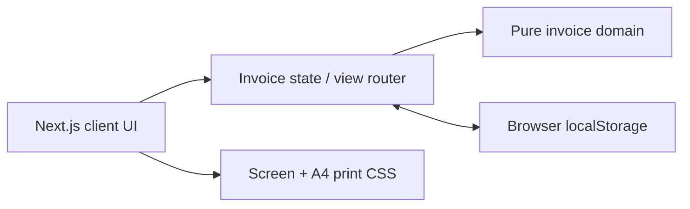
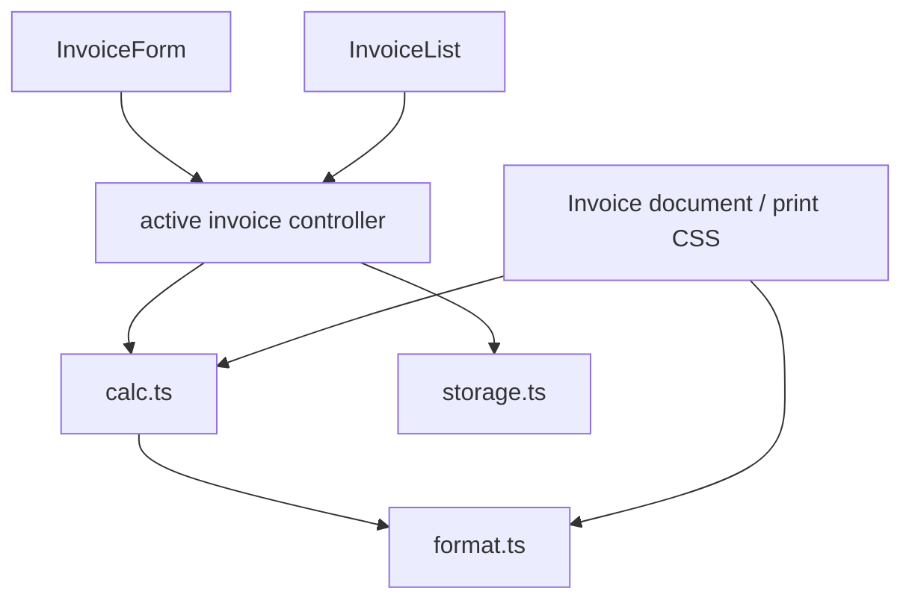

# Architecture: Invoice Maker

## Scope and shape

**Paradigm:** client-only, single-page stateful application with a pure domain core.

The product is one application route in a static Next.js export (`out/`) served as HTML, CSS, and JavaScript. It makes no API, analytics, or server calls. Browser storage is the only persistence boundary.

## Build seed

| Area | Seed |
| --- | --- |
| Web app | Next.js App Router, TypeScript, React client components where browser APIs or interactive state are needed |
| Output | `next.config.ts` with `output: 'export'`; `npm run build` produces `out/` |
| Tests | Unit tests for `src/lib`; Playwright for user journeys and 375px/1280px layouts; ESLint via the `lint` script |
| Data | `src/lib/invoice.ts` owns persisted types and schema version; `src/lib/calc.ts` owns totals; `src/lib/storage.ts` owns localStorage |
| UI | `src/app/` owns shell and view routing; feature components own rendering only; CSS owns screen, responsive, and print presentation |

Use the currently supported Next.js 16.x line when the app is initialized. Static export is an explicit fit: it emits the `out/` folder and excludes server features. [Next.js static export docs](https://nextjs.org/docs/app/guides/single-page-applications), [Next.js support policy](https://nextjs.org/support-policy).

## Architecture decisions

### AD-1 — Client-only static export

**Binds:** deployment, data access, and runtime features.

**Prevents:** a later story introducing server state, accounts, API routes, or network dependencies.

**Rule:** Configure static export. All application data remains in the browser; no route handlers, server actions, remote requests, telemetry, or external assets are required for core operation. Components that use browser APIs are client components and access `window`/`localStorage` only after mount, so static prerendering never evaluates them.

### AD-2 — One canonical invoice model and mutation path

**Binds:** form editing, list display, duplication, persistence, and printing.

**Prevents:** screens creating incompatible invoice shapes or persisting derived values as competing sources of truth.

**Rule:** `Invoice` and `LineItem` types, including a `schemaVersion`, are defined once in `src/lib/invoice.ts`. A separate `DraftInvoice` owns raw form strings; the controller retains raw input and field errors until it parses to a valid `Invoice`. Canonical numeric values are finite non-negative base-10 decimals; discount and VAT are constrained to 0–100. Invalid drafts are never persisted and block printing/saving. Canonical dates are date-only `YYYY-MM-DD`; a new invoice's due date is 14 local-calendar days after its invoice date and is independent once the user edits it. UI events update the active draft through a single reducer/controller. List rows and print output derive from the validated model; only validated invoice fields and audit fields (`id`, `createdAt`, `updatedAt`) are persisted.

### AD-3 — Exact monetary calculation at the domain boundary

**Binds:** totals, formatting, saved totals, and tests.

**Prevents:** floating-point display errors or separate calculation formulas in components.

**Rule:** All monetary inputs are parsed by the domain layer into an exact decimal/minor-unit representation before arithmetic. `calculateTotals(invoice)` is pure and is the sole source for line amounts, subtotal, discount, VAT, and total. Round each line amount half-up to AED fils (two decimals), sum those rounded line amounts as the subtotal, then round discount and VAT half-up to fils; total is `subtotal − discount + VAT`. UI formats values only through `formatAed`.

### AD-4 — Versioned, defensive browser persistence

**Binds:** localStorage key, record lifecycle, reload behavior, and invalid-data handling.

**Prevents:** malformed or old local data breaking application startup, unordered lists, or duplicate IDs/numbers.

**Rule:** `storage.ts` exclusively reads and writes one namespaced versioned collection envelope and validates each record at read time. It accepts only known schema versions and ignores invalid or future-version records without overwriting their raw storage value. It generates stable UUID IDs; `createdAt` and `updatedAt` are UTC epoch milliseconds, with `updatedAt` changed only after a successful save. Lists sort by `(updatedAt DESC, id DESC)`. A write re-reads the collection immediately before updating one record, so distinct records from two tabs are retained; concurrent edits to the same record are last successful save wins. A `storage` event refreshes the list; unsaved draft edits remain local. Invoice-number sequencing remains a product-policy question, not a storage-side effect.

### AD-5 — One semantic invoice, two presentation modes

**Binds:** component markup and responsive/print styling.

**Prevents:** print markup drifting from editable invoice content or screen breakpoints affecting A4 output.

**Rule:** `InvoiceDocument` is the sole presentational projection of a validated invoice and calculated totals; `InvoiceForm` provides editing controls around it. Screen controls carry a shared non-printable selector; `@media print` hides all controls and list/navigation chrome, defines A4 page geometry, permits multi-page line items, and does not depend on viewport breakpoints. `isPartyEmpty` is defined once as all supported party fields blank after trim; only then is that party section hidden. Screen CSS is mobile-first with no horizontal overflow at 375px and a capped readable content width at 1280px.

## Boundary ownership

- Components do not access `localStorage`, calculate totals, or generate invoice numbers.
- `calc.ts` has no browser or React imports; its table-driven tests cover every total rule.
- `storage.ts` has no UI imports and only returns validated domain objects.
- The controller initializes browser storage only after mount, shows a deterministic pre-hydration shell, and never lets an initial empty screen overwrite persisted data.
- The controller persists an explicit save and save-on-leave according to the selected UX; it never serializes a partially parsed invalid numeric field.

## Operational envelope

- Build artifact: `out/`, deployable to any static host. No runtime service, database, secret, or background job exists.
- Supported data is device/browser-local and may be cleared by the user or browser. The UI must not promise backup, cross-device access, or recovery.
- Offline use is required after assets load; do not add remote fonts, CDN dependencies, APIs, or analytics.
- Accessibility baseline: native labels, keyboard-operable actions, semantic table/form markup, visible focus states, and confirmation before destructive delete.

## Verification contract

- Unit tests first: calculation, decimal parsing/rounding, formatting, invoice number generation, validation/normalization, storage ordering, duplicate, and delete.
- Playwright: create/edit invoice, reload persistence, list/open/duplicate/delete confirmation, print trigger/content selectors, and 375px/1280px no-overflow checks.
- `make ci` is the acceptance gate; it runs setup and all check stages against the committed tree.

## Open question requiring product correction

1. STORY-001 says quantity `0.1` times unit price `0.2` must show `AED 0.04`; the stated totals formula makes that `AED 0.02`. This is not a rounding choice. The Board must correct the expected value or input values before STORY-001's test is written.
2. The PRD MVP says invoice numbers do not auto-increment across sessions, while its assumptions index says they increment globally in the same browser. The Board must select one policy before STORY-001 implements number generation.

## Deferred

- Cross-tab live synchronization of an open form is not part of the MVP; list refresh and per-record conflict behavior are fixed in AD-4.
- Migrations for future schema versions are deferred; versioning is reserved now so a later change has an owner.
- Browser print engines control the final print dialog and PDF renderer; the app controls print CSS and A4 geometry only.
